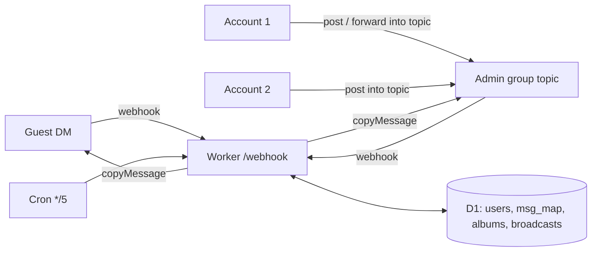

# Passeur

**English** · [简体中文](README.zh-CN.md)

A two-way Telegram private-chat relay bot on Cloudflare Workers + D1 — one forum topic per guest, several admin accounts.

<!-- TODO: replace with a screenshot of the admin group (docs/assets/topic.png) -->
```text
Guest (DM with @your_bot)              Admin group · topic "Alice · 123456789"
──────────────────────────             ─────────────────────────────────────────
Alice: hi, is the camera still   ──▶   🤖 Alice: hi, is the camera still for sale?
       for sale?
                                 ◀──   Account 1: yes — photos below  [album]
🤖 yes — photos below  [album]
                                 ◀──   Account 2: (forwards a channel post here)
🤖 (the post, copied)
```
*Guests only ever see the bot. Both of your accounts answer from the same topic.*

## Contents

- [Why Passeur?](#-why-passeur)
- [Highlights](#-highlights)
- [Quick Start](#-quick-start)
- [Deployment](#-deployment)
- [Usage](#-usage)
- [Configuration](#-configuration)
- [Update & Maintenance](#-update--maintenance)
- [How It Works](#-how-it-works)
- [Project Structure](#-project-structure)
- [Development](#-development)
- [FAQ & Troubleshooting](#-faq--troubleshooting)
- [Security](#-security)
- [Limitations & Roadmap](#-limitations--roadmap)
- [Documentation](#-documentation)
- [License](#-license)

## 💡 Why Passeur?

You want strangers to reach you on Telegram without exposing your account, and you want to answer from more than one account. Passeur gives each guest a topic in a private forum group; anything an admin posts in that topic — typed, forwarded, an album — is delivered to the guest as the bot.

- ✅ Good fit: one person (or a few trusted accounts) handling DMs from the public, at zero hosting cost.
- ❌ Not a fit: a support desk with roles and assignment, or thousands of guests a day — use a helpdesk product, or a bot on a paid server.

## ✨ Highlights

- **One topic per guest** — history stays separated; the topic is named after the guest and renamed when they change their name.
- **Several admin accounts** — every account in `ADMIN_IDS` can answer; forward anything from anywhere straight into a guest's topic.
- **Albums stay albums** — media groups are buffered and sent in one piece, in both directions.
- **Replies and edits follow** — replying to a specific message threads it on the other side; text and caption edits are mirrored.
- **Spam control** — a one-tap math captcha for new guests, a per-guest rate limit, and `/block`.
- **List topics** — a topic can stand for a group of guests: whatever you post or forward there goes to everyone on its list.
- **Broadcast** — send one message to every verified guest, batched to stay within free-plan limits.
- **Free to run** — about 2 Worker requests, ~25 D1 rows read and ~2 written per message; a personal bot uses well under 1% of the free quota.

## 🚀 Quick Start

Requires Node.js 22.13+, a Cloudflare account and a bot token from [@BotFather](https://t.me/BotFather).

1. Create a **supergroup**, turn on **Topics**, and add your bot as an admin with **Manage Topics**.
2. Clone and run the installer; it asks for anything missing and deploys:

   ```bash
   git clone https://github.com/10ta/Passeur.git
   cd Passeur
   ./update.sh
   ```

   It ends with `==> 完成：webhook 待处理 0 条` and tells you the next step.
3. From each admin account, DM the bot `/id`; put the numbers in `ADMIN_IDS` in `.env`. Add those accounts to the group, send `/id` there, put the result in `GROUP_ID`, then run `./update.sh` again.
4. In the group's **General** topic send `/check` — every line should start with ✅.
5. Message the bot from any other account: a topic named after that account appears in the group.

## 🚢 Deployment

> [!IMPORTANT]
> Cloudflare's free quotas are **per account**, shared with your other Workers: 100,000 requests/day, 5 Cron Triggers (Passeur uses 1), 5 GB of D1 storage. A Cloudflare API token, if you use one, can act on the whole account.

### Requirements

| Component | Version | Notes |
|---|---|---|
| Node.js | ≥ 22.13 | runs `update.sh` helpers and the tests |
| bash, curl | any | `update.sh` is bash; run it as `./update.sh` from any shell, fish included |
| Cloudflare | Workers Free or Paid | `npx wrangler login`, or an API token with Workers Scripts:Edit + D1:Edit |

| Platform to run `update.sh` | Supported |
|---|---|
| Linux (Debian/Ubuntu) | ✅ |
| macOS | ✅ |
| Windows (outside WSL) | ❌ |

### What `update.sh` does

Every step is idempotent, so the same command installs and updates:

1. Creates `.env` from `.env.example` (mode 600), prompts for empty values, and checks that `GROUP_ID` is a group the bot can see.
2. Creates the D1 database `passeur` in Western Europe (close to Telegram's API servers) if it doesn't exist, and writes `wrangler.toml` from `wrangler.example.toml`.
3. Applies `migrations/`, deploys the Worker, and pushes the settings as Worker secrets.
4. Points the Telegram webhook at `https://<worker>/webhook` with a secret header, and sets the command menus.

Without a terminal (cron, CI) it never prompts: it fails if a required value is missing.

### Custom domain

Add a route or custom domain to the Worker in the Cloudflare dashboard, set `WORKER_URL` in `.env` to it, and run `./update.sh` to move the webhook.

## 🧭 Usage

### Reply to a guest

Open the guest's topic and write. Everything that is not a `/command` goes to the guest: text, media, stickers, voice, albums. Both admin accounts can reply in the same topic.

### Forward something to a guest from account 1

From any chat, **Forward** → pick the admin group → pick the guest's topic. The guest receives it like a normal forward, with "Forwarded from" the original source. Your own accounts never show: a message that originates from any admin account or the admin group is copied instead, including admins whose forward privacy hides their account (matched by name). To hide sources, change **Forward source** in `/settings` (globally or for one session).

### Reply to a specific message

Use Telegram's **Reply** in the topic; the guest sees it as a reply to their own message. It works the other way too.

### Send one message to several guests

A topic is a recipient list: a guest's own topic reaches that one guest, a **list topic** reaches everyone ticked on its list.

1. `/newlist Clients` creates the topic `📤 Clients` with a panel inside. Tick guests (☐/☑); each tap is saved at once, up to 45 people. `/list` in that topic brings the panel back.
2. Post or forward anything into `📤 Clients` — text, media, albums. It is copied to every member who isn't blocked.
3. 👌 appears on your message when everyone got it; otherwise the bot replies with who didn't and why.

Guest topics always stay one-to-one, because a guest's replies come back to their own topic. Keep conversations between your admin accounts out of list topics: every message there is sent.

### Change settings

Send `/settings` in **General**. The panel shows the global settings; **💬 会话设置** opens a list of sessions (list topics first, then guests by recent activity, 20 per page, ⚙️ marks those with their own settings), and picking one shows that session's settings. Everything happens by editing that one message in General, so you never type inside a guest's topic. Each button cycles through the options and saves at once; the panel shows where each value comes from (session, global, `.env` or default). Choosing **默认 / 跟随全局** removes the override.

| Setting | Global | Per topic | Options |
|---|---|---|---|
| Forward source | ✅ | ✅ | keep (default) · channels only · hide |
| New-guest captcha | ✅ | ❌ | on (default) · off |
| Guest rate limit | ✅ | ❌ | 10 · 20 (default) · 60 per minute · off |
| Message-link retention | ✅ | ❌ | 30 · 90 (default) · 365 days |

### Commands

| Command | Where | What it does |
|---|---|---|
| `/info` | guest topic | Guest's name, username, ID and status |
| `/block` / `/unblock` | guest topic | Silently drop / accept the guest's messages |
| `/settings` | General | Settings panel: global, and per session under 💬 会话设置 |
| `/newlist <name>` | anywhere in the group | Create a list topic `📤 <name>` with its member panel |
| `/list` | list topic | Post the member panel again |
| `/broadcast` | General, as a reply | Send the replied message to every verified, unblocked guest |
| `/cancel` | General | Stop a running broadcast |
| `/blocked`, `/stats` | anywhere in the group | Blocked list; user counts |
| `/check` | anywhere in the group | Verify Topics, bot permissions and admin accounts; in a group that isn't `GROUP_ID`, says so |
| `/id` | group or DM | Show the chat ID (works before `GROUP_ID` is set) |
| `/help` | anywhere in the group | This list |

Only accounts in `ADMIN_IDS` can use them; other group members are ignored. The exception is `/id` and `/check` in a group that isn't `GROUP_ID`, which answer anyone so a wrong setup can be found.

## 🔧 Configuration

Connection settings live in `.env` (template: [`.env.example`](.env.example)); `update.sh` pushes them to the Worker as secrets on every run, so edit `.env` and re-run rather than changing them in the dashboard. The last four rows are only starting values: the `/settings` panel overrides them (see [Change settings](#change-settings)), resolved as topic → panel → `.env` → default.

| Name | Required | Default | Description |
|---|---|---|---|
| `BOT_TOKEN` | ✅ | — | Token from @BotFather |
| `ADMIN_IDS` | ✅ | — | Admin account IDs, comma-separated |
| `GROUP_ID` | ✅ | — | Forum supergroup ID (`-100…`); empty = setup mode, only `/id` answers |
| `WEBHOOK_SECRET` | ✅ | generated | Telegram sends it back on every webhook call |
| `WORKER_URL` | ✅ | from deploy output | Base URL of the Worker |
| `CLOUDFLARE_API_TOKEN` | ❌ | — | Only if you don't use `npx wrangler login` |
| `CLOUDFLARE_ACCOUNT_ID` | ❌ | — | Only if the token sees several accounts |
| `WELCOME_TEXT` | ❌ | built-in | Reply to `/start`; `\n` for line breaks |
| `VERIFY` | ❌ | `1` | Math captcha for new guests |
| `RATE_LIMIT_PER_MIN` | ❌ | `20` | Messages per guest per minute; `0` = off |
| `FORWARD_SOURCE` | ❌ | `all` | `all` / `channel` / `none`: keep "Forwarded from" for forwarded messages (legacy `FORWARD_CHANNEL_POSTS=1` = `channel`) |
| `RETENTION_DAYS` | ❌ | `90` | How long reply/edit links between messages are kept |

## 🔄 Update & Maintenance

### Update

```bash
git pull
./update.sh
```

### Data and backup

Everything is in the D1 database `passeur`: guests, block list, topic IDs, and message pairs (kept `RETENTION_DAYS`). Messages themselves stay in Telegram.

```bash
npx wrangler d1 export passeur --remote --output backup.sql
```

Restore into a fresh database with `npx wrangler d1 execute passeur --remote --file backup.sql`.

### Logs

```bash
npx wrangler tail passeur
```

Errors also appear in the group's General topic, and in Workers Logs in the dashboard (kept 3 days on the free plan).

### Uninstall

```bash
./uninstall.sh
```

It asks before each step: remove the webhook, delete the Worker (with its secrets and cron), delete the D1 database. The Telegram group is left alone.

## 🧠 How It Works



- **A topic is a recipient list** → a guest topic maps to its guest (`users.topic_id`), a list topic to its members (`list_members`); one send path, one rule.
- **Topic ↔ guest is a row in D1** → any admin account can answer, and nothing about the guest lives in the bot's memory.
- **Typed messages are copied, forwarded ones keep their source** → the guest sees the bot, never the admin account that answered; origins that are admin accounts or the admin group are always copied.
- **Settings resolve topic → panel → `.env` → default** → one registry in `src/settings.js`; per-topic options use the same table with scope `t:<topic>`.
- **The webhook always returns 200** → Telegram never retries, so a message is never sent twice; failures are reported in the topic or General instead.
- **Albums are buffered for 2.5 s in `waitUntil`** → waiting costs wall time, not CPU, so it fits the 10 ms CPU limit; each item is claimed exactly once.
- **Broadcast runs 40 guests per batch** → the free plan allows 50 outbound requests per invocation; the 5-minute cron continues the job.
- **Every per-message query uses a key or index** → rows read stay close to rows returned.

### Cost per message (measured on the test doubles)

| Path | Worker requests | D1 queries | D1 rows written | CPU |
|---|---|---|---|---|
| Guest → topic | 1 | 3 | ~2 | < 1 ms |
| Topic → guest | 1 | 2 | ~2 | < 1 ms |
| New guest (topic + card) | 1 | 8 | ~5 | < 1 ms |

The cron adds 288 requests/day. On the free plan the first limit you'd reach is 100,000 requests/day for the whole account.

## 📁 Project Structure

```text
.
├── src/
│   ├── index.js       # Worker entry: webhook auth, routing, cron
│   ├── guest.js       # Guest DMs: captcha, rate limit, relay to topic, edits
│   ├── admin.js       # Admin group: relay to guest, commands, /check
│   ├── relay.js       # copy/forward, albums, topic creation and recovery
│   ├── broadcast.js   # Batched broadcast
│   ├── lists.js       # List topics: member panel, fan-out
│   ├── settings.js    # Settings registry, resolution, /settings panel
│   ├── db.js          # All D1 queries
│   └── telegram.js    # Bot API client
├── migrations/        # D1 schema
├── scripts/env.mjs    # .env and JSON helpers for update.sh
├── test/              # node:test suite with fake D1 and Telegram
├── update.sh          # Install / update (idempotent)
└── uninstall.sh       # Remove Worker, D1, webhook
```

## 🔨 Development

```bash
npm install
npm test
npm run build
```

`npm test` runs the suite against a real SQLite copy of the schema and a fake Bot API; it needs no network. `npm run build` bundles the Worker without deploying (`Total Upload: … KiB`). Telegram cannot reach `wrangler dev` on localhost, so end-to-end checks happen on the deployed Worker. Agent conventions are in [AGENTS.md](AGENTS.md).

## ❓ FAQ & Troubleshooting

**Guests get “Delivery failed” or no reply, `/check` in the group stays silent, `update.sh` warned `chat not found`**
→ `GROUP_ID` is not the admin group's ID. The usual culprit is the `-123…` in Telegram Web's address bar; the Bot API writes the same group as `-100123…`.
→ Send `/id` in the admin group (anyone can, even before setup is right), put the value in `.env`, run `./update.sh`. `update.sh` also detects a missing `-100` and offers the corrected value.

## 🔒 Security

- The webhook only accepts requests carrying `WEBHOOK_SECRET` in `X-Telegram-Bot-Api-Secret-Token`.
- Only `ADMIN_IDS` can relay or run commands. Messages from admins posting as **"Remain anonymous"** are refused, since the real sender is hidden.
- `.env` holds the bot token and is kept at mode 600; `update.sh` passes the token to curl through stdin, never on the command line.
- If the bot token leaks, revoke it in @BotFather, put the new one in `.env`, run `./update.sh`.

## 🚧 Limitations & Roadmap

- Edits sync text and captions only; replacing a photo is not mirrored.
- A guest's message sent before passing the captcha is kept only if it was the first one (one album item at most).
- Broadcast sends a single message; a replied-to album broadcasts its first item.
- List topics: at most 45 members (one Bot API call each within the free plan's 50 per invocation); edits are not synced; a guest's reply to a list message lands in their topic without the reply link.
- Admin text starting with `/` is treated as a command, not sent.
- A flood from one guest still costs one Worker request per message even when dropped.

### Environment facts to confirm

| Fact | Status | How to confirm |
|---|---|---|
| When the bot forwards a message that was itself forwarded, the guest sees the original source, not the admin group | confirmed 2026-11-10 | — |
| Telegram returns `TOPIC_CLOSED` when the bot posts into a closed topic | assumed; Passeur reopens the topic | Close a topic, message the bot from that guest |
| D1 bills an extra row written per index touched | assumed from docs | `meta.rows_written` of a message insert in Workers Logs |

## 📚 Documentation

- [AGENTS.md](AGENTS.md): commands, invariants and gotchas for AI coding agents.
- [.env.example](.env.example): every setting with a comment.
- [migrations/0001_init.sql](migrations/0001_init.sql): database schema with column notes.

## 📄 License

MIT © 2026 10ta — see [LICENSE](LICENSE).
