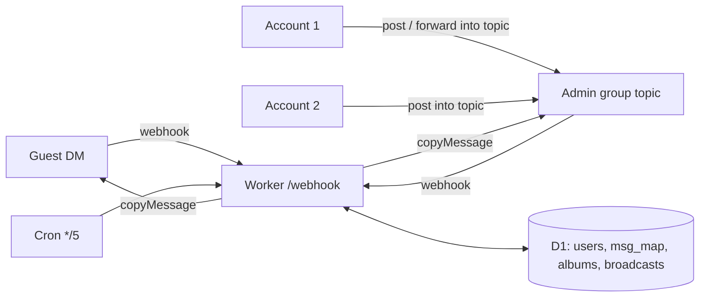

# Passeur

[English](README.md) · **简体中文**

跑在 Cloudflare Workers + D1 上的 Telegram 双向私聊机器人：每个访客一个论坛话题，多个管理员账号共同回复。

<!-- TODO: 换成管理群截图 (docs/assets/topic.png) -->
```text
Guest (DM with @your_bot)              Admin group · topic "Alice · 123456789"
──────────────────────────             ─────────────────────────────────────────
Alice: hi, is the camera still   ──▶   🤖 Alice: hi, is the camera still for sale?
       for sale?
                                 ◀──   Account 1: yes — photos below  [album]
🤖 yes — photos below  [album]
                                 ◀──   Account 2: (forwards a channel post here)
🤖 (the post, copied)
```
*访客只看得到 bot；你的两个号在同一个话题里回复。*

## 目录

- [为什么是 Passeur？](#-为什么是-passeur)
- [亮点](#-亮点)
- [快速开始](#-快速开始)
- [部署](#-部署)
- [使用](#-使用)
- [配置](#-配置)
- [更新与维护](#-更新与维护)
- [工作原理](#-工作原理)
- [项目结构](#-项目结构)
- [开发](#-开发)
- [安全](#-安全)
- [局限与路线](#-局限与路线)
- [文档地图](#-文档地图)
- [许可](#-许可)

## 💡 为什么是 Passeur？

你想让陌生人能在 Telegram 上联系你，又不想暴露自己的账号，还想用不止一个号来回复。Passeur 在一个私有论坛群里给每位访客开一个话题；管理员在话题里发的任何东西（手打的、转发来的、相册）都会以 bot 的身份送达访客。

- ✅ 适用：个人或少数几个可信账号，处理来自公开渠道的私聊，零托管成本。
- ❌ 不适用：需要分工、指派的客服团队，或每天上千访客——请用专门的客服系统，或部署在付费服务器上的 bot。

## ✨ 亮点

- **一个访客一个话题**：聊天记录互不混杂；话题以访客名字命名，对方改名时自动同步。
- **多个管理员账号**：`ADMIN_IDS` 里的每个号都能回复；在任何地方看到的内容可以直接转发进访客的话题。
- **相册保持为相册**：媒体组会先缓冲再整组发送，双向都是。
- **回复与编辑同步**：回复某条具体消息，对面看到的也是回复；文字和图片说明的修改会同步过去。
- **防骚扰**：新访客点一下完成算术验证，每人限速，另有 `/block`。
- **广播**：一条消息发给所有已验证的访客，分批发送以免超出免费额度。
- **零成本运行**：每条消息约 2 次 Worker 请求、读约 25 行、写约 2 行 D1；个人用量不到免费额度的 1%。

## 🚀 快速开始

需要 Node.js 22.13+、一个 Cloudflare 账号，以及 [@BotFather](https://t.me/BotFather) 给的 bot token。

1. 建一个**超级群**，打开**话题（Topics）**，把 bot 设为管理员并勾选**管理话题**。
2. 克隆并运行安装脚本，它会询问缺少的配置并完成部署：

   ```bash
   git clone https://github.com/10ta/Passeur.git
   cd Passeur
   ./update.sh
   ```

   最后会输出 `==> 完成：webhook 待处理 0 条`，并提示下一步。
3. 用每个管理员号私聊 bot 发 `/id`，把数字填进 `.env` 的 `ADMIN_IDS`。把这些号拉进群，在群里发 `/id`，结果填进 `GROUP_ID`，再运行一次 `./update.sh`。
4. 在群的 **General** 话题里发 `/check`，每一行都应以 ✅ 开头。
5. 用任意其他账号私聊 bot：群里会出现一个以该账号命名的话题。

## 🚢 部署

> [!IMPORTANT]
> Cloudflare 的免费额度是**按账号**计算的，与你的其他 Worker 共用：每天 100,000 次请求、5 个 Cron Trigger（Passeur 占 1 个）、D1 共 5 GB。如果使用 Cloudflare API Token，它能操作整个账号。

### 前置要求

| 组件 | 版本 | 说明 |
|---|---|---|
| Node.js | ≥ 22.13 | 运行 `update.sh` 的辅助脚本和测试 |
| bash、curl | 任意 | `update.sh` 是 bash 脚本；在任何 shell（包括 fish）里用 `./update.sh` 运行 |
| Cloudflare | Workers 免费版或付费版 | `npx wrangler login`，或带 Workers Scripts:Edit + D1:Edit 权限的 API Token |

| 运行 `update.sh` 的平台 | 支持 |
|---|---|
| Linux（Debian/Ubuntu） | ✅ |
| macOS | ✅ |
| Windows（WSL 之外） | ❌ |

### `update.sh` 做了什么

每一步都是幂等的，所以安装和更新是同一条命令：

1. 从 `.env.example` 创建 `.env`（权限 600），并询问为空的配置项。
2. D1 数据库 `passeur` 不存在时，在西欧创建（靠近 Telegram 的 API 服务器），并由 `wrangler.example.toml` 生成 `wrangler.toml`。
3. 应用 `migrations/`，部署 Worker，把配置作为 Worker secrets 推上去。
4. 把 Telegram webhook 指向 `https://<worker>/webhook` 并带上密钥头，同时设置命令菜单。

没有终端时（cron、CI）它不会提问：缺少必填项就直接失败。

### 自定义域名

在 Cloudflare 后台给 Worker 加路由或自定义域名，把 `.env` 里的 `WORKER_URL` 改成它，然后运行 `./update.sh` 迁移 webhook。

## 🧭 使用

### 回复访客

打开该访客的话题直接写。只要不是 `/命令`，都会发给访客：文字、媒体、贴纸、语音、相册。两个管理员号都能在同一个话题里回复。

### 用号1 把内容转给访客

在任意聊天里点**转发** → 选管理群 → 选该访客的话题。bot 会把它复制给访客，不带“转发自”标记，所以你的两个号都不会露出来。设置 `FORWARD_CHANNEL_POSTS=1` 后，从频道转发的帖子会保留原频道来源。

### 回复某条具体消息

在话题里用 Telegram 的**回复**；访客看到的是对他那条消息的回复。反方向同理。

### 命令

| 命令 | 位置 | 作用 |
|---|---|---|
| `/info` | 访客话题 | 访客的名字、用户名、ID 和状态 |
| `/block` / `/unblock` | 访客话题 | 静默丢弃 / 恢复接收该访客的消息 |
| `/broadcast` | General，回复某条消息 | 把被回复的那条消息发给所有已验证、未拉黑的访客 |
| `/cancel` | General | 停止进行中的广播 |
| `/blocked`、`/stats` | 群内任意位置 | 拉黑列表；用户统计 |
| `/check` | 群内任意位置 | 检查话题开关、bot 权限和管理员账号 |
| `/id` | 群或私聊 | 显示聊天 ID（`GROUP_ID` 未设置时也可用） |
| `/help` | 群内任意位置 | 显示这张表 |

只有 `ADMIN_IDS` 里的账号能用；其他群成员的消息一律忽略。

## 🔧 配置

配置写在 `.env` 里（模板：[`.env.example`](.env.example)）。`update.sh` 每次运行都会把它们作为 secrets 推到 Worker，所以请改 `.env` 后重新运行，不要在后台直接改。

| 名称 | 必填 | 默认值 | 说明 |
|---|---|---|---|
| `BOT_TOKEN` | ✅ | — | @BotFather 给的 token |
| `ADMIN_IDS` | ✅ | — | 管理员账号 ID，逗号分隔 |
| `GROUP_ID` | ✅ | — | 论坛超级群 ID（`-100…`）；为空时进入设置模式，只响应 `/id` |
| `WEBHOOK_SECRET` | ✅ | 自动生成 | Telegram 每次调用 webhook 时回传的密钥 |
| `WORKER_URL` | ✅ | 取自部署输出 | Worker 的根地址 |
| `CLOUDFLARE_API_TOKEN` | ❌ | — | 不用 `npx wrangler login` 时才需要 |
| `CLOUDFLARE_ACCOUNT_ID` | ❌ | — | token 能看到多个账号时才需要 |
| `VERIFY` | ❌ | `1` | 新访客需通过算术验证 |
| `RATE_LIMIT_PER_MIN` | ❌ | `20` | 每位访客每分钟消息数上限；`0` 为关闭 |
| `FORWARD_CHANNEL_POSTS` | ❌ | `0` | `1` = 频道帖子用转发而非复制，以保留来源 |
| `RETENTION_DAYS` | ❌ | `90` | 消息之间的回复 / 编辑对应关系保留天数 |
| `WELCOME_TEXT` | ❌ | 内置 | 回复 `/start` 的内容；用 `\n` 换行 |

## 🔄 更新与维护

### 更新

```bash
git pull
./update.sh
```

### 数据与备份

所有数据都在 D1 数据库 `passeur` 里：访客、拉黑列表、话题 ID，以及消息对应关系（保留 `RETENTION_DAYS` 天）。消息内容本身留在 Telegram 里。

```bash
npx wrangler d1 export passeur --remote --output backup.sql
```

恢复到新数据库：`npx wrangler d1 execute passeur --remote --file backup.sql`。

### 日志

```bash
npx wrangler tail passeur
```

错误也会发到群的 General 话题，并记录在后台的 Workers Logs 里（免费版保留 3 天）。

### 卸载

```bash
./uninstall.sh
```

每一步都会先确认：解除 webhook、删除 Worker（连同 secrets 和定时任务）、删除 D1 数据库。Telegram 群不会被动。

## 🧠 工作原理



- **话题与访客的对应是 D1 里的一行** → 任何管理员号都能回复，bot 内存里不保存访客的任何状态。
- **默认复制而非转发** → 访客看到的永远是 bot，看不到是哪个管理员号回的。
- **webhook 始终返回 200** → Telegram 不会重试，消息不会重复发送；失败会在话题或 General 里报告。
- **相册在 `waitUntil` 里缓冲 2.5 秒** → 等待消耗的是墙钟时间而不是 CPU，符合 10 毫秒 CPU 限制；每个相册项只会被认领一次。
- **广播每批 40 人** → 免费版每次调用最多 50 个外部请求；剩下的由每 5 分钟一次的定时任务接着发。
- **每条消息涉及的查询都走主键或索引** → 读取行数与返回行数基本一致。

### 每条消息的开销（在测试替身上实测）

| 路径 | Worker 请求 | D1 查询 | D1 写入行 | CPU |
|---|---|---|---|---|
| 访客 → 话题 | 1 | 3 | ~2 | < 1 ms |
| 话题 → 访客 | 1 | 2 | ~2 | < 1 ms |
| 新访客（建话题 + 信息卡） | 1 | 8 | ~5 | < 1 ms |

定时任务每天另加 288 次请求。免费版最先触到的上限是整个账号每天 100,000 次请求。

## 📁 项目结构

```text
.
├── src/
│   ├── index.js       # Worker entry: webhook auth, routing, cron
│   ├── guest.js       # Guest DMs: captcha, rate limit, relay to topic, edits
│   ├── admin.js       # Admin group: relay to guest, commands, /check
│   ├── relay.js       # copy/forward, albums, topic creation and recovery
│   ├── broadcast.js   # Batched broadcast
│   ├── db.js          # All D1 queries
│   └── telegram.js    # Bot API client
├── migrations/        # D1 schema
├── scripts/env.mjs    # .env and JSON helpers for update.sh
├── test/              # node:test suite with fake D1 and Telegram
├── update.sh          # Install / update (idempotent)
└── uninstall.sh       # Remove Worker, D1, webhook
```

## 🔨 开发

```bash
npm install
npm test
npm run build
```

`npm test` 用一份真实 SQLite 建的表结构和一个假的 Bot API 跑测试，不需要联网。`npm run build` 只打包不部署（输出 `Total Upload: … KiB`）。Telegram 访问不到本机的 `wrangler dev`，所以端到端验证要在部署后的 Worker 上做。面向编码代理的约定见 [AGENTS.md](AGENTS.md)。

## 🔒 安全

- webhook 只接受在 `X-Telegram-Bot-Api-Secret-Token` 里带有 `WEBHOOK_SECRET` 的请求。
- 只有 `ADMIN_IDS` 能转达消息或使用命令。开着**“保持匿名”**的管理员发的消息会被拒绝，因为看不到真实发送者。
- `.env` 存有 bot token，权限保持 600；`update.sh` 通过标准输入把 token 交给 curl，从不出现在命令行参数里。
- token 泄露时：在 @BotFather 里重置，把新 token 填进 `.env`，运行 `./update.sh`。

## 🚧 局限与路线

- 编辑同步只覆盖文字和图片说明；替换图片不会同步。
- 访客在通过验证前发的消息只保留第一条（相册最多保留其中一项）。
- 广播只发一条消息；回复的是相册时只广播第一项。
- 管理员以 `/` 开头的文字会被当作命令，不会发出。
- 单个访客刷屏时，即使消息被丢弃，每条仍会消耗一次 Worker 请求。

### 环境事实与待确认事项

| 事项 | 状态 | 确认方法 |
|---|---|---|
| 转发一条“转发自频道”的消息时，来源仍显示为原频道（`FORWARD_CHANNEL_POSTS=1`） | 推断 | 把频道帖子转进话题，看访客那边的显示 |
| bot 往已关闭的话题发消息时，Telegram 返回 `TOPIC_CLOSED` | 推断；Passeur 会重新打开话题 | 关闭一个话题，再用该访客给 bot 发消息 |
| D1 对每个被改动的索引额外计一行写入 | 据文档推断 | 在 Workers Logs 里看一次消息写入的 `meta.rows_written` |

## 📚 文档地图

- [AGENTS.md](AGENTS.md)：面向 AI 编码代理的命令、不变量和坑。
- [.env.example](.env.example)：每个配置项及其注释。
- [migrations/0001_init.sql](migrations/0001_init.sql)：数据库结构及字段说明。

## 📄 许可

MIT © 2026 10ta，见 [LICENSE](LICENSE)。
