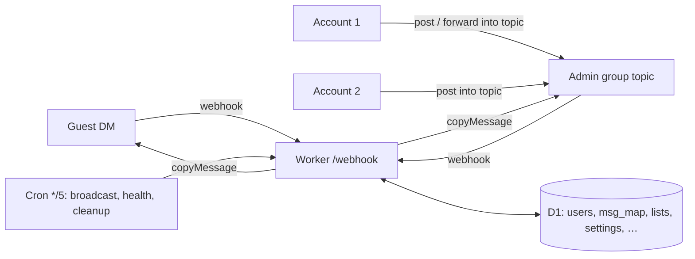

# How Passeur works

**English** · [简体中文](how-it-works.zh-CN.md)

## Overview

- **A topic is a recipient list** → a guest topic maps to its guest (`users.topic_id`), a list topic to its members (`list_members`); one send path, one rule.
- **Topic ↔ guest is a row in D1** → any admin account can answer, and nothing about the guest lives in the bot's memory.
- **Typed messages are copied, forwarded ones keep their source** → the guest sees the bot, never the admin account that answered; origins that are admin accounts or the admin group are always copied.
- **Settings resolve topic → panel → `.env` → default** → one registry in `src/settings.js`; per-topic options use the same table with scope `t:<topic>`.
- **The webhook always returns 200** → Telegram never retries, so a message is never sent twice; failures are reported in the topic or General instead.
- **Albums are buffered for 2.5 s in `waitUntil`** → waiting costs wall time, not CPU, so it fits the 10 ms CPU limit; each item is claimed exactly once.
- **Broadcast runs 40 guests per batch** → the free plan allows 50 outbound requests per invocation; the 5-minute cron continues the job.
- **Every per-message query uses a key or index** → rows read stay close to rows returned.
- **List messages are mirrored into each recipient's topic** → a silent, labelled copy right after delivery; what the 50-call budget or Telegram's per-group rate limit (~20 messages a minute) leaves out is mirrored when that guest next writes, so a reply always has its context.
- **The topic icon is the inbox** → `users.waiting` flips when the guest writes and when a reply is delivered; only those flips cost a Bot API call.
- **The cron also watches the webhook** → `getWebhookInfo` every 5 minutes; one alert when deliveries fail or pile up, one note on recovery.

## Cost per message

Measured on the test doubles (`node:sqlite` + fake Bot API); CPU includes the fakes, so it is an upper bound.

| Path | Worker requests | D1 queries | D1 rows changed | Bot API calls | CPU |
|---|---|---|---|---|---|
| New guest (topic + card + status icon) | 1 | 14 | 6 | 5 | < 3 ms |
| Guest → topic, already waiting | 1 | 4 | 1 | 1 | < 1 ms |
| Guest → topic, starts waiting | 1 | 6 | 2 | 2 | < 1 ms |
| Topic → guest | 1 | 3 | 1 | 1 | < 1 ms |
| Topic → guest, answers (icon reset) | 1 | 4 | 3 | 2 | < 1 ms |

D1 bills an extra row written for each index a write touches, so real `rows_written` is a little higher. The cron adds 288 requests/day. On the free plan the first limit you'd reach is 100,000 Worker requests/day for the whole account.
