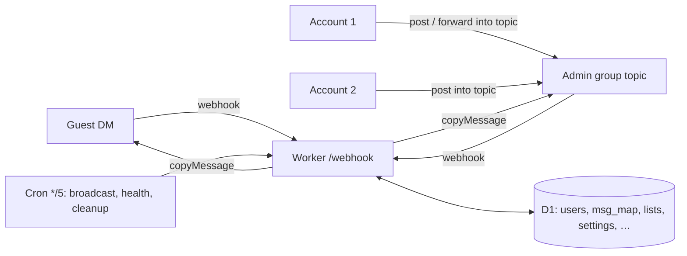

# Passeur 工作原理

[English](how-it-works.md) · **简体中文**

## 概览

- **话题就是收件人名单** → 访客话题对应它的访客（`users.topic_id`），名单话题对应它的成员（`list_members`）；同一条发送路径，同一条规则。
- **话题与访客的对应是 D1 里的一行** → 任何管理员号都能回复，bot 内存里不保存访客的任何状态。
- **手打的消息复制，转发来的消息保留来源** → 访客看到的是 bot，看不到是哪个管理员号回的；来源是管理员账号或管理群本身时一律复制。
- **设置按 话题 → 面板 → `.env` → 默认 解析** → 全部登记在 `src/settings.js` 一张表里；单个话题的设置用同一张表，作用域为 `t:<话题>`。
- **webhook 始终返回 200** → Telegram 不会重试，消息不会重复发送；失败会在话题或 General 里报告。
- **相册在 `waitUntil` 里缓冲 2.5 秒** → 等待消耗的是墙钟时间而不是 CPU，符合 10 毫秒 CPU 限制；每个相册项只会被认领一次。
- **广播每批 40 人** → 免费版每次调用最多 50 个外部请求；剩下的由每 5 分钟一次的定时任务接着发。
- **每条消息涉及的查询都走主键或索引** → 读取行数与返回行数基本一致。
- **名单消息会抄进每个收件人的话题** → 送达后立刻静音转发一份，顶部显示发出它的管理员（若用复制，会和访客的消息一样显示为 bot 发的）；受 50 次调用预算或 Telegram 单群限流（每分钟约 20 条）影响没抄成的，等那位访客下次发消息时补上，所以回复总有上下文。
- **话题图标就是收件箱** → 访客发消息、回复送达时切换 `users.waiting`；只有切换那一刻才调用 Bot API。
- **定时任务顺带盯着 webhook** → 每 5 分钟查一次 `getWebhookInfo`；投递失败或积压时报警一次，恢复时再说一次。

## 每条消息的开销

在测试替身上实测（`node:sqlite` + 假 Bot API）；CPU 时间包含替身本身，是上限。

| 路径 | Worker 请求 | D1 查询 | D1 改动行 | Bot API 调用 | CPU |
|---|---|---|---|---|---|
| 新访客（建话题 + 信息卡 + 状态图标） | 1 | 14 | 6 | 5 | < 3 ms |
| 访客 → 话题，已在等待中 | 1 | 4 | 1 | 1 | < 1 ms |
| 访客 → 话题，开始等待 | 1 | 6 | 2 | 2 | < 1 ms |
| 话题 → 访客 | 1 | 3 | 1 | 1 | < 1 ms |
| 话题 → 访客，即回复（图标复原） | 1 | 4 | 3 | 2 | < 1 ms |

D1 对写入时涉及的每个索引额外计一行，所以实际 `rows_written` 会略高一些。定时任务每天另加 288 次请求。免费版最先触到的上限是整个账号每天 100,000 次 Worker 请求。
